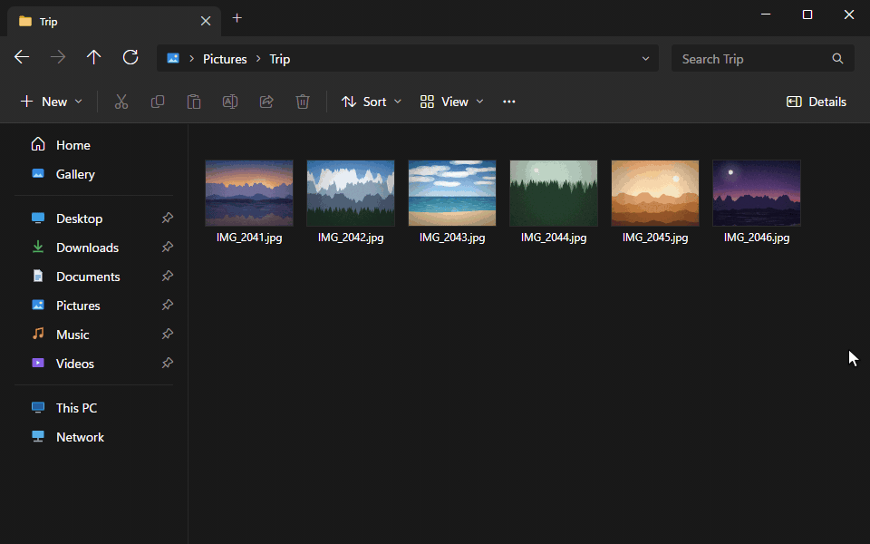
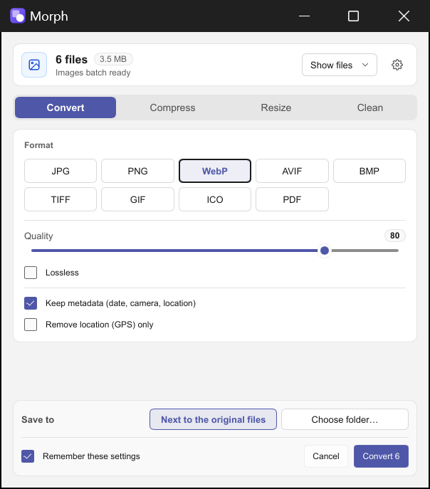
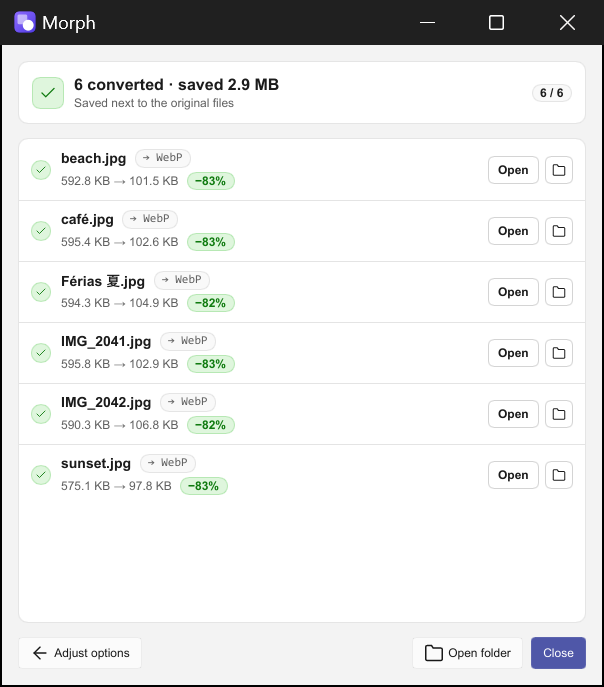
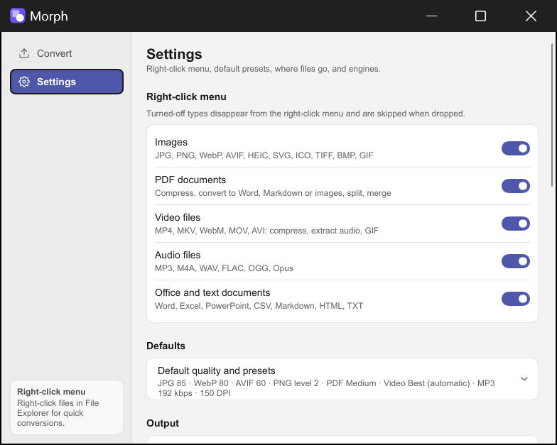

  

<h1 align="center">Morph</h1>

Convert files right from the Windows 11 right-click menu.

  
  
  

  

Select files in File Explorer, right-click, and pick **Morph ▸ Convert to WebP…**, **Compress…** and more. Morph handles images, PDFs, video, audio and Office documents. New files are saved next to the originals, and the originals are never changed.

## Download

**[Download the latest release](https://github.com/renangomide/morph/releases/latest)**: get `Morph-<version>-x64.zip`.

1. Right-click the zip → **Properties** → tick **Unblock** → **OK**.
2. Right-click the zip → **Extract All…** → **Extract**.
3. In the extracted folder, double-click **`Install.cmd`**.
4. If "Windows protected your PC" appears, click **More info** → **Run anyway**. When Windows asks for administrator permission, click **Yes**.
5. Right-click any supported file in File Explorer → **Morph ▸**.

**Why does Windows warn?** Morph is signed with a self-signed certificate ("OpenMorph"), not a paid code-signing certificate (yet). `Install.cmd` needs administrator permission once, to add that certificate (`Morph.cer`) to the machine's *Trusted People* store. It is not added to the trusted root authorities. Then the app is installed for your user only.

**Uninstall:** double-click `Uninstall.cmd` (it can also remove the certificate), or Settings ▸ Apps ▸ Installed apps ▸ Morph ▸ Uninstall. This removes the menu entry, the program and its data. Files you converted are kept.

**Requirements**

- Windows 11, 64-bit (x64).
- For Word, Excel, PowerPoint and OpenDocument files: Microsoft Office or the free [LibreOffice](https://www.libreoffice.org/download/). CSV ↔ XLSX, and Markdown/TXT/HTML to Markdown, HTML or TXT, work without either.

## What it converts

The menu shows the most common actions for what you selected. The window it opens lists every option.

| Type | Inputs | What you can do |
|---|---|---|
| **Images** | JPG, PNG, WebP, AVIF, HEIC/HEIF, GIF (first frame), BMP, TIFF, ICO, TGA, QOI, SVG | Convert to JPG, PNG, WebP, AVIF, BMP, TIFF, GIF, ICO, or PDF (one per image). Compress: *Best (automatic)* keeps the smallest file that still looks identical, or set a quality or a target size. Resize. Remove metadata or just the GPS location, rotate, flip. |
| **PDF** | PDF | Convert to Word, Markdown, HTML, plain text or images (PNG/JPG/WebP). Compress (Low / Medium / High / Custom). Split. Merge several PDFs (and images) into one. |
| **Video** | MP4, MKV, MOV, AVI, WebM, WMV, FLV, M4V, MPG/MPEG, TS, MTS, 3GP | Convert to MP4, MKV, WebM, MOV, AVI (without re-encoding when possible). Compress: *Best (automatic)*, Balanced, Smaller, Discord (≤ 10 MB), Email (≤ 25 MB) or a custom size. Extract audio. Convert to GIF. Uses the GPU (NVIDIA, Intel, AMD) when available. |
| **Audio** | MP3, WAV, FLAC, AAC, M4A, OGG, Opus, WMA, AIFF | Convert to MP3, M4A (AAC), WAV, FLAC, OGG (Vorbis), Opus. Keeps tags and cover art. |
| **Documents** | Word (DOC, DOCX, ODT, RTF), Excel (XLS, XLSX, ODS, CSV), PowerPoint (PPT, PPTX, ODP), text (MD, TXT, HTML) | To PDF, Markdown, images (pages/slides) and between formats (e.g. DOCX ↔ ODT, XLSX ↔ CSV, PPTX ↔ ODP, Markdown → DOCX). |

Selecting files of different types gives **Convert N files…**, with one section per type. Selecting only images and PDFs also gives **Combine into one PDF…**. Batches run in parallel, and one failed file never stops the others. You can send a job to the background (tray icon) and get a notification when it is done.

Starting **Morph** from the Start menu opens a window where you can drop files, and the Settings: which file types appear in the menu, default quality, output folder, Office engine, theme.

## Screenshots

| Options | Progress | Settings |
|---|---|---|
|  |  |  |

## Privacy

- **Works offline.** Every conversion runs on your PC. Files are never uploaded.
- **No telemetry, no account, no ads.** Morph contains no network code (its FFmpeg is even built without network support) and does not check for updates.
- **Links open only when you click them** (Download LibreOffice, GitHub, Report an issue), in your browser.
- **Your originals are never modified, moved or deleted.** Results are new files: `photo.webp`, `photo (compressed).jpg`, `photo (1).webp`, and so on.
- Logs stay on your PC (see the FAQ).

## FAQ

**Does it work on Windows 10?**
No. Morph adds its entry to the modern Windows 11 right-click menu, which Windows 10 doesn't have.

**Why does SmartScreen warn me when I install it?**
The package is signed with a self-signed certificate, not a paid one, so Windows doesn't know the publisher. See [Download](#download). All the source code is in this repository.

**Morph doesn't show up in the right-click menu.**
Make sure you right-clicked a supported file (not a folder) and that its type is turned on in Settings ▸ File types. Restarting File Explorer, or signing out and back in, after installing can help.

**Where are the logs?**
Start menu ▸ Morph ▸ Settings ▸ About ▸ **Open log folder**.

**How do I report a bug?**
[Open an issue](https://github.com/renangomide/morph/issues/new/choose). Include your Windows version, the Morph version (Settings ▸ About), what you did, and the log file. A sample file helps a lot if you can share it. Security problems: see [SECURITY.md](SECURITY.md).

## Building from source

See [BUILDING.md](BUILDING.md).

## Contributing

See [CONTRIBUTING.md](CONTRIBUTING.md). The full design is in [SPEC.md](SPEC.md).

## License

Morph is free software under the [GNU General Public License v3.0 or later](LICENSE).
Bundled third-party components keep their own licenses: see [THIRD_PARTY_NOTICES.md](THIRD_PARTY_NOTICES.md). The bundled FFmpeg is built by [morph-ffmpeg](https://github.com/renangomide/morph-ffmpeg), which publishes the build scripts and the complete corresponding source.
